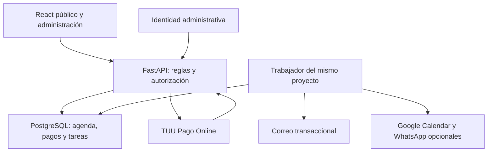

# Agendamiento propio para Enfermera Estética

> Actualización de implementación (4 noviembre 2026): las decisiones posteriores del usuario prevalecen sobre las propuestas originales. PostgreSQL 15 local y conexión preparada para Neon; horario inicial de 20 citas, pausas de 10 minutos, almuerzo incluido y sin pausa final obligatoria; editor por día/grupos/vigencia y excepciones; cuidados editables con modal previo; exclusivamente TUU Pago Online, sin TUU Reserva. Ver AGENDA_LOCAL.md para uso y alcance implementado.

Fecha de revisión: 4 de noviembre de 2026. Documento de viabilidad y diseño; no es una implementación ni una certificación de producción.

## 1. Recomendación y alcance

**Es viable incorporar la agenda completa a EnfEstPage conservando React y FastAPI.** La integración de cobro existente aporta un adaptador TUU aprovechable, pero todavía no constituye un sistema persistente de pagos o reservas. La mayor parte del trabajo nuevo estará en disponibilidad, transacciones, administración y recuperación de incidencias, no en dibujar el calendario.

Recomiendo un monolito modular: un repositorio, una base PostgreSQL y el mismo código Python ejecutado como API y como trabajador de tareas. React permanece en Vercel; como opción principal, API y trabajador se alojan en Render, con Supabase para PostgreSQL y autenticación administrativa. FullCalendar Standard cubre el calendario diario/semanal de la imagen con filtro por profesional. Resend es una primera opción para correo. Google Calendar y WhatsApp se incorporan después, sin participar en la confirmación de una reserva.

No hay una razón técnica clara para migrar a Next.js, sustituir FastAPI, crear microservicios o comprar FullCalendar Premium para la vista semanal de una profesional. El costo operativo estimado de la opción principal parte de unos USD 59/mes antes de impuestos, excesos y comisiones TUU; se desglosa en la sección 5. Una variante que conserva la API y un despachador periódico en Vercel Pro puede reducir componentes y partir de USD 45/mes, a cambio de trabajar con ejecuciones acotadas.

La agenda será propia. TUU Pago Online procesará cobros, sin depender de una API de TUU Reserva. No se presupone que TUU permita cancelar intentos, consultar todos sus estados o devolver dinero mediante el mismo contrato documentado de Pago Online: esos puntos necesitan validación específica antes de automatizarlos.

## 2. Evidencia local y límites de la revisión

Se accedió a los archivos reales de:

- `D:\Documents\PERSONAL PROJECTS\FULL_STACK_FAST_API_REACT\EnfEstPage`
- `D:\Documents\PERSONAL PROJECTS\FULL_STACK_FAST_API_REACT\EnfEstCalendar`

Se usó el árbol de trabajo local, no una copia de GitHub. Se comprobaron `git status --short`, diferencias normales y diferencias en staging. No se encontraron archivos `AGENTS.md` en ambos árboles de proyecto ni en sus directorios superiores revisados, hasta `D:\`. Se respetaron las instrucciones entregadas en la conversación. No se abrieron archivos `.env` ni se obtuvieron credenciales de producción.

### Estado sin commit

| Proyecto | Observado |
|---|---|
| EnfEstPage | Sin diferencias de archivos rastreados ni staging. Cuatro archivos nuevos sin seguimiento: `public/icono-v0.4.svg`, `public/logo-largo-v0.3.jpeg`, `public/logo-medio-v0.4.jpeg`, `public/logo-small-v0.4.png`. Se inventariaron; no se hizo evaluación gráfica de estos archivos. |
| EnfEstCalendar | Archivos de aplicación, configuración, README y recursos aparecen sin seguimiento. Se leyó este código local aunque no esté comprometido en Git. No se debe interpretar un diff vacío como ausencia de este trabajo. |

### Verificaciones ejecutadas

| Verificación | Resultado y alcance |
|---|---|
| ESLint en EnfEstPage | Código de salida 0 usando dependencias locales, sin `--fix`. |
| ESLint en EnfEstCalendar | Código de salida 0 usando dependencias locales, sin `--fix`. |
| Análisis AST Python | Los siete archivos de `api/` se analizaron correctamente, sin importarlos ni cargar settings. |
| Dependencias | Se leyeron manifiestos y lockfiles; React 18.3.1 y Vite 4.5.14 en ambos lockfiles. React Router 7.13.2 en Page y 7.18.2 en Calendar. FullCalendar React 7.0.2 en Calendar, también instalado localmente. |
| Pruebas automatizadas | No se encontraron suites de pruebas ni scripts de test en los árboles revisados. Tampoco migraciones, configuración de base de datos o CI del proyecto. |
| Sitios públicos | El lector web no logró acceder a las dos URLs proporcionadas. Esto no prueba una caída del sitio. No se verificó funcionalidad en producción. |

No se ejecutó build, auditoría exhaustiva de dependencias, navegador funcional, callbacks contra TUU ni pruebas de concurrencia reales. Las pruebas de la sección 13 son criterios futuros de implementación, no resultados obtenidos. No se enviaron correos, crearon reservas reales, iniciaron cobros, desplegaron cambios ni tocaron DNS.

## 3. Qué conservar, extender o reemplazar

Referencias relativas a la raíz de EnfEstPage, salvo las indicadas como EnfEstCalendar. Los números corresponden al contenido local revisado.

| Área | Observado en código | Propuesta |
|---|---|---|
| Estructura React | `src/App.jsx:14–28` define sitio público y páginas de pago. `package.json:6–31` usa Vite, React, Router y Tailwind. | Conservar. Añadir `/reservar`, consulta segura de reserva y `/admin/*`, con carga diferida del calendario. |
| Identidad visual | `src/index.css:5–26` define rosa, fondos suaves y texto marrón. `src/ui/AppLayout.jsx:5–17` compone navegación. | Reutilizar variables y componentes; layout administrativo más ancho y compacto. |
| Recursos nuevos | `src/ui/Logo.jsx:5–15` sigue referenciando los logos anteriores. | Los cuatro recursos sin commit no están conectados aquí; decidir su uso visual aparte, sin reemplazarlos durante este análisis. |
| Entrada a reserva | `src/pages/Home.jsx:37–43` dirige el botón de agenda a contacto; `src/ui/Navbar.jsx:29–44` no incluye agenda propia. | Cambiar la entrada a `/reservar` únicamente durante la transición controlada. |
| Catálogo | `src/pages/Catalog.jsx:3–10` muestra un iframe Heyzine. `src/data/services.json:1–26` contiene seis servicios con título/descripción, sin precio, duración ni identificador estable. | Mantener el catálogo editorial si se desea; crear catálogo reservable en DB. No extraer precios operativos desde iframe ni desde texto libre. |
| Horario público | `src/pages/Contact.jsx:33–38` tiene lunes–sábado 09:00–20:00 escrito en JSX. | Derivar resumen del horario publicado para no contradecir los nuevos turnos por día. |
| FastAPI | `api/index.py:22–100` expone health, creación de pago, callback y validación del resultado. | Conservar framework y separar routers de catálogo, disponibilidad, reservas, pagos y administración. |
| Settings | `api/config.py:11–29` declara entorno TUU, secreto protegido con `SecretStr`, URLs y abono global. | Conservar validación de configuración. Agregar DB, correo y autenticación; precios y abonos comerciales pasan a datos versionados. |
| Firma TUU | `api/tuu.py:16–61` ordena parámetros `x_`, genera HMAC-SHA256 y compara con `compare_digest`. | Reutilizar con pruebas de contrato y casos de campos vacíos, Unicode y valores inválidos. |
| Creación de pago | `api/payment.py:45–73` construye payload y URLs; `:111–158` llama a TUU y retorna checkout/referencia. | Mantener adaptador HTTP. Recibir un intento persistido con importe calculado, en lugar de generar referencia sin guardarla. |
| Importe | `api/payment.py:12,57,157` usa abono del servidor. `src/pages/Payment.jsx:10` muestra otro valor configurable en frontend. | Lo primero es una buena base; eliminar la doble fuente. Mostrar un presupuesto emitido por API con precio, abono y saldo. |
| Callback | `api/callback.py:41–73` valida firma, cuenta, moneda, abono global y prefijo de referencia. `:76–102` solo devuelve datos y escribe log. `api/index.py:62–83` descarta ese resultado y responde OK. | Extender de forma sustancial: buscar intento por referencia exacta, persistir evento, comparar importe esperado, aplicar estado idempotente y confirmar cupo dentro de transacción. |
| Resultado del navegador | `api/result.py:14–40` valida criptográficamente datos devueltos al navegador, sin leer DB. `src/pages/PaymentResult.jsx:9–58` consulta una sola vez. | Conservar la verificación como señal auxiliar. La pantalla deberá consultar el estado persistido y tolerar callback demorado. |
| Cancelación de checkout | `src/pages/PaymentCancelled.jsx:12–29` afirma que el abono no se completó solo por estar en esa ruta. | Sustituir por consulta del intento y textos prudentes: salir del checkout no prueba ausencia de cobro. |
| Datos de cliente | `api/schemas.py:6–43` valida datos básicos y normaliza teléfono. | Reutilizar, fortaleciendo validación posterior al trim; reservar sin cuenta de cliente. Agregar aceptación versionada y límites contra abuso. |
| Deploy | `vercel.json:3–11` enruta `/api/*` a `/api/index` y el resto a la SPA. `vite.config.js:9–15` tiene proxy local a FastAPI. | Conservar SPA/proxy de desarrollo. Si se separa API, ajustar reescritura o base URL, callback y reglas de origen. No duplicar dos APIs activas para las mismas reservas. |
| Backend incompleto para agenda | `requirements.txt:1–3` solo incorpora FastAPI, httpx y pydantic-settings; no se hallaron persistencia, auth ni scheduler. | Añadir SQLAlchemy, driver PostgreSQL, Alembic, auth y trabajador. No considerar el health actual una prueba de conectividad a DB/proveedores. |

### Riesgos concretos del pago actual

Una firma válida demuestra integridad del mensaje, pero no que su referencia corresponda a una reserva existente. Validar solamente el prefijo `ABONO-` no establece esa relación. Sin almacenamiento no existe defensa de negocio contra reprocesamiento, trazabilidad para devoluciones o conciliación de un pago abandonado en el navegador.

El abono global tampoco permite comparar correctamente pagos antiguos después de cambiar el precio: debe validarse contra el importe congelado en cada intento. `api/payment.py:111–119` no transforma explícitamente timeouts o errores de transporte a un estado persistido desconocido; la URL devuelta se acepta por prefijo HTTP/HTTPS en `:148–152`, por lo que conviene exigir HTTPS y hosts documentados del proveedor. El parser de callback (`api/callback.py:28–37`) toma el primer valor de parámetros repetidos y su decodificación ocurre fuera del bloque de errores específico de callback en `api/index.py:57–64`: limitar tamaño, validar formato, rechazar duplicados ambiguos y manejar errores de decodificación explícitamente.

Estas observaciones no significan que el cobro actual no funcione; explican por qué no basta para confirmar reservas concurrentes. No se comprobaron transacciones de producción.

### Valor de EnfEstCalendar

| Referencia local | Valor aprovechable / limitación |
|---|---|
| `EnfEstCalendar/src/features/calendar/CalendarFullCalendar.jsx:3–10` | Integración local con FullCalendar 7 y tema. Su importación usa API de v7: no reemplazarla mecánicamente por ejemplos antiguos de v6. |
| Mismo archivo `:167–205`, `:226–264`, `:302–350` | Navegación semanal, encabezados y representación de eventos pueden servir de punto de partida visual. |
| Mismo archivo `:12–33`, `:85–145` | Cuatro bloques fijos por día y lookup por fecha/hora exacta. No calcula intervalos, almuerzos, excepciones o colisiones parciales. Reemplazar este motor. |
| Mismo archivo `:61–88`, `:275–296` | Maneja fechas locales del navegador, oculta domingo y limita visualización a 18:00. Debe adoptar America/Santiago, mostrar cierre dominical y llegar al menos a 20:00. |
| `EnfEstCalendar/src/pages/Calendar.jsx:7–43`, `:53–91` | Guarda en localStorage y elimina registros; no hay base central, auditoría ni concurrencia. No reutilizar esta persistencia. |
| `EnfEstCalendar/src/App.jsx:9–17` | La ruta llamada administrativa no tiene autenticación. No es una barrera de seguridad. |
| `EnfEstCalendar/src/features/calendar/ReservaModal.jsx:6–20`, `:73–106` | Modal útil como referencia, pero no tiene correo, pagos, catálogo por ID ni distinción de notas internas; cancelación debe reemplazar eliminación. |

**Decisión:** reutilizar selectivamente presentación y experiencia del prototipo dentro de EnfEstPage. No mantener un segundo producto de agenda ni migrar el backend principal a ese repositorio. Si hay reservas reales en su localStorage, solo se podrán descubrir/exportar desde el navegador donde se registraron; revisar el código no permite saber si existen.

## 4. Motor de disponibilidad y bloques personalizados

### Configuración inicial explícita

| Tratamiento | Precio total CLP | Abono CLP | Saldo tras abono | Duración provisional |
|---|---:|---:|---:|---:|
| Limpieza facial profunda | 28.000 | 10.000 | 18.000 | 120 min |
| Limpieza facial Glass Skin (+ dermaplaning) | 34.000 | 10.000 | 24.000 | 120 min |
| Limpieza facial nano-infusión | 37.000 | 10.000 | 27.000 | 120 min |

Categoría: Limpiezas Faciales. Profesional inicial: Camila Vela-Ruiz. Horario base: lunes–sábado 09:00–20:00; domingo cerrado. Pausa base: 15 minutos. Anticipación pública: 13 horas reales. Recordatorios: desactivados inicialmente. Duraciones, indicaciones y cambios a pausas requieren validación profesional antes de publicación.

### Conceptos que deben separarse

| Concepto | Ejemplo | Efecto |
|---|---|---|
| Jornada de atención | Lunes 12:00–19:00 | Límite de trabajo publicado de la profesional. |
| Ventana reservable | 12:00–16:10 y 16:40–18:40 | Períodos donde puede transcurrir una atención. No todo minuto de jornada tiene que ser reservable. |
| Inicio ofrecido | 12:00, 14:10, 16:40 | Horas exactas elegibles en modo de bloques. |
| Duración | 120 min | Tiempo de tratamiento, sin incluir pausa. |
| Pausa posterior | 10 o 15 min | Tiempo de recuperación/preparación que impide otra cita. |
| Almuerzo / pausa fija | 16:10–16:40 | Se conserva aunque una cita anterior no se venda. |
| Intervalo de oferta | Cada 10 min en modo flexible | Separación entre candidatos, no duración de cita ni descanso. |
| División visual | Líneas cada 10/30/60 min | Solo dibujo del calendario. No decide disponibilidad. |

FullCalendar distingue opciones visuales como `slotDuration` y horas de negocio; la aplicación debe calcular las reglas de reserva en el backend. [Documentación visual](https://fullcalendar.io/docs/slotDuration), [horas de negocio](https://fullcalendar.io/docs/businessHours).

### Dos modos sobre un único motor

1. **Bloques con inicios explícitos**, recomendado para tu ejemplo: se publican solo los inicios configurados, con capacidad temporal por bloque. Si alguien toma la segunda cita antes que la primera, el resto de los horarios no se desplaza. Cancelar la primera tampoco adelanta las demás.
2. **Ventanas flexibles**: el motor genera candidatos a partir de un anclaje y paso configurables, y descarta los que no admiten duración, pausa y restricciones. Un anclaje de 09:20 permite empezar a las 09:20 aunque no sea múltiplo de una grilla global.

En ambos modos se comprueban profesional habilitada para servicio, fecha publicable, 13 horas, cierre, almuerzo, vacaciones, bloqueos, citas y retenciones vigentes. Consultar disponibilidad nunca garantiza el cupo: solo una retención confirmada por el servidor lo garantiza temporalmente.

### Tu semana como plantilla editable

Esta tabla representa exactamente los inicios y fines pedidos. Es una **plantilla propuesta**, no una sustitución automática de la configuración base de 15 minutos.

| Día | Citas ofrecidas | Descansos explícitos | Almuerzo | Salida | Citas / horas de atención |
|---|---|---|---|---|---|
| Lunes | 12:00–14:00; 14:10–16:10; 16:40–18:40 | 14:00–14:10 | 16:10–16:40 | 19:00 | 3 / 6 h |
| Martes | 09:00–11:00; 11:10–13:10; 13:40–15:40 | 11:00–11:10 | 13:10–13:40 | 17:00 | 3 / 6 h |
| Miércoles | 11:00–13:00; 13:10–15:10; 15:40–17:40; 17:50–19:50 | 13:00–13:10; 17:40–17:50 | 15:10–15:40 | 19:50 | 4 / 8 h |
| Jueves | 09:00–11:00; 11:10–13:10; 13:40–15:40; 15:50–17:50 | 11:00–11:10; 15:40–15:50 | 13:10–13:40 | 19:00 | 4 / 8 h |
| Viernes | 09:00–11:00; 11:10–13:10; 13:40–15:40; 15:50–17:50 | 11:00–11:10; 15:40–15:50 | 13:10–13:40 | 17:50 | 4 / 8 h |
| Sábado | 09:20–11:20; 11:30–13:30 | 11:20–11:30 | 13:30–14:00 | 15:00 | 2 / 4 h |
| Domingo | Cerrado | — | — | — | 0 |

Total: 20 citas y 40 horas de tratamiento por semana, antes de bloqueos y ausencias. Los espacios sobrantes antes de la salida NO crean citas adicionales en modo de bloques.

### Resolución de pausas, almuerzo y salida

- Guardar `buffer_after_minutes` del tratamiento y una posible excepción explícita por plantilla/bloque. La configuración base sigue siendo 15; para reproducir la tabla, la plantilla requiere aprobar 10 minutos como excepción. No se debe recortar una preparación clínica obligatoria mediante un ajuste de diseño.
- Separar `treatment_end`, `occupied_until` y `shift_end`. Por defecto, atención y pausa deben caber en jornada. Con duración 120 y pausa 15, el último inicio flexible antes de cierre 20:00 sería 17:45 si la grilla lo permite.
- Ofrecer una opción explícita «permitir pausa posterior fuera de jornada»: atención hasta 20:00 y ocupación hasta 20:15 serían posibles. Esa ocupación sigue bloqueando otra reserva y se ve en administración. No confundir terminar tratamiento con terminar trabajo.
- Para terminar exactamente a las 19:50 del miércoles o 17:50 del viernes sin trabajar después, debe configurarse pausa final cero y validarse profesionalmente. Alternativamente la salida real se mueve 10 minutos. La interfaz debe advertir la incompatibilidad, no decidirla en silencio.
- El ejemplo usa almuerzo en lugar del descanso adicional: tras 13:10 puede reservarse 13:40. Propuesta: `break_covers_buffer=true` cuando la pausa representa tiempo sin citas y puede quedar contenida en el almuerzo. Si preparación y almuerzo requieren tiempos separados, usar `false` y desplazar el almuerzo o la siguiente cita. Un requisito clínico no debe suponerse compatible sin validación.
- Técnicamente, el almuerzo es una restricción de ventanas para el tratamiento; cuando cubre pausa, no se inserta como una segunda ocupación exclusiva que chocaría con la pausa de la cita. Los bloqueos duros, en cambio, entran en la tabla común de ocupación y no admiten superposición.

### Editor por día, grupo y excepción

Seleccionar profesional, días de semana y vigencia; crear bloques de cita, descanso y almuerzo; duplicar a otros días y editar horas. «Repetir cita de 120 + descanso de 10» puede generar un borrador; el administrador inserta almuerzo y revisa resultado antes de publicar. Martes/jueves/viernes comparten el comienzo y pueden partir de una plantilla común, manteniendo distinta hora final.

Precedencia propuesta: excepción de fecha reemplaza la plantilla semanal; plantilla profesional reemplaza el horario general; cierres explícitos y vacaciones bloquean. Evitar unión silenciosa de plantillas contradictorias. Publicación atómica, versionada y con vista previa de semanas futuras. Si el cambio afecta citas o retenciones, mostrar la lista y rechazar publicación hasta resolverla; nunca mover reservas automáticamente.

Las plantillas se almacenan como hora civil y zona `America/Santiago`, con fechas de vigencia. Las instancias usan `timestamptz`/UTC más zona y horario local de referencia. No fijar UTC-3 ni UTC-4. Rechazar horas inexistentes o exigir desambiguación para horas repetidas; actualizar tzdata y detectar si una actualización cambia futuras conversiones. Las 13 horas se comparan entre instantes del servidor, no con la fecha del navegador. Una retención puede continuar dentro de su TTL aunque durante el checkout quede menos de 13 horas; después de expirar, una nueva retención debe volver a cumplirlas.

### Más de un tratamiento

El modelo debe admitir desde el inicio `booking_items` ordenados; la primera versión pública puede limitar a uno. Para una combinación autorizada: sumar precios y abonos por ítem, congelar duraciones y pausas, retener todo el intervalo de forma atómica y mostrar el final real. Dos tratamientos de 120 minutos con una pausa intermedia de 15 ocupan 255 minutos de atención/transición, más la pausa final; no equivalen automáticamente a una cita de cuatro horas.

Las combinaciones entre limpiezas faciales pueden no ser apropiadas: introducir una lista de combinaciones habilitadas por la profesional, no permitir cualquier carrito. Una combinación que cruza almuerzo se rechaza inicialmente; citas separadas o multijornada son otro flujo. En modo bloques, no unir dos bloques por simple coincidencia de inicios: su separación y pausas deben coincidir con el plan del combo. Si varias profesionales intervienen, reservar todos los recursos en una transacción y adquirir locks en orden estable; diferir esa complejidad de la primera versión.

## 5. Arquitectura y alternativas proporcionales



El trabajador es otro proceso del mismo producto, no otro microservicio con base independiente. Comparte modelos y reglas, pero no recibe tráfico público. Una caída del correo no revierte una reserva confirmada. Un fallo de Google Calendar no bloquea el cobro.

### Comparación técnica

| Área | Opción recomendada | Alternativas y motivo |
|---|---|---|
| Base de datos | PostgreSQL administrado; Supabase Pro como paquete DB + Auth | Neon PostgreSQL con cobro por uso es válido; el sondeo frecuente de tareas reduce beneficio de suspensión. Render PostgreSQL facilita cercanía con API/worker, pero auth se decide aparte. SQLite/localStorage no son adecuados como agenda compartida de esta propuesta. |
| Acceso a datos | SQLAlchemy + Alembic desde FastAPI; esquema privado para tablas de negocio | No hacer escrituras de reservas directamente desde navegador hacia la Data API: evita duplicar reglas y transacciones. Si se expone algún esquema, RLS y permisos restrictivos. |
| Calendario | FullCalendar Standard v7 con filtros de profesional, día y semana | React Big Calendar tiene licencia MIT y es alternativa viable, pero aquí no ofrece ventaja concreta frente al prototipo existente. Un calendario propio aumenta trabajo de interacción, fechas y accesibilidad. Premium solo si se requieren vistas de recursos simultáneos/timeline u otras funciones pagadas. |
| Autenticación | Supabase Auth solo para personal, acceso por invitación, MFA y roles en DB | OIDC de Google con lista de usuarios autorizados reduce contraseñas propias, pero requiere flujo OAuth/sesiones. Auth propia implica recuperación, hash, revocación y mayor mantenimiento. No se recomienda desarrollarla desde cero para una profesional. |
| Tareas | Tabla persistente PostgreSQL + worker Python con leases, reintentos y outbox | Vercel Pro Cron puede despachar lotes acotados desde la misma DB. Celery + Redis/RabbitMQ es opción madura si aumenta carga, pero añade infraestructura y no elimina la necesidad de outbox/deduplicación. `BackgroundTasks` o timers solos no son una cola durable. |
| Correo | Resend por API; registros de entrega y adaptador reemplazable | Postmark ofrece correo transaccional y precio inicial razonable. SMTP genérico puede servir, pero complica correlación de estados y no garantiza idempotencia. La identidad del remitente se validará al implementar, sin cambios DNS ahora. |
| Hosting | React en Vercel; FastAPI y worker en Render; DB/Auth en Supabase | Mantener FastAPI en Vercel también es viable, con tareas periódicas en lotes y pooling de conexiones. Un VPS único puede reducir factura, pero añade parches, backups, supervisión y recuperación a tu cargo. |

Fuentes técnicas: [FastAPI en Vercel](https://vercel.com/docs/frameworks/backend/fastapi), [worker de Render](https://render.com/docs/background-workers), [Celery y brokers](https://docs.celeryq.dev/en/stable/getting-started/backends-and-brokers/index.html), [BackgroundTasks](https://fastapi.tiangolo.com/tutorial/background-tasks/), [JWT de Supabase](https://supabase.com/docs/guides/auth/jwts), [licencia React Big Calendar](https://github.com/bigcalendar/react-big-calendar/blob/master/LICENSE).

**Preferencia operativa:** API y worker continuos por claridad de ejecución y recuperación, sin depender de memoria del proceso. Si el presupuesto manda, mantener API en Vercel Pro y ejecutar despachador cada minuto es una alternativa seria para este volumen: la durabilidad sigue en PostgreSQL. El despachador debe tener autenticación de servicio, límites por lote, lease y presupuesto de ejecución. No se debe iniciar un bucle infinito dentro de una función HTTP.

La documentación actual de Vercel admite FastAPI; no es correcto decir que FastAPI no puede funcionar allí. Sus funciones tienen límites de ejecución y sus cron tienen restricciones por plan. Hobby permite cron diario; Pro permite por minuto. Eso no convierte al cron en cola durable ni garantiza entrega puntual. [Límites de cron](https://vercel.com/docs/cron-jobs/usage-and-pricing).

### Precios publicados y estimaciones

Consulta documental al 04-11-2026. Importes en USD salvo indicación contraria; no son una cotización contractual. No se inspeccionó el plan real contratado por el negocio.

| Servicio | Precio/límite confirmado en fuente pública | Interpretación para esta propuesta |
|---|---|---|
| Vercel Pro | USD 20/mes como base publicada; uso adicional según plan | Presupuestar base si se conserva Vercel. Hobby se restringe a uso personal no comercial; no asumir que sirve para esta web comercial. |
| Supabase Pro | Desde USD 25/mes, primer proyecto incluido; 8 GB DB y backups diarios con 7 días de retención | Base recomendada de producción. PITR no está incluido en esa cifra. Free tiene 500 MB y pausa tras inactividad, por lo que no lo uso como presupuesto de producción. |
| Render cómputo | USD 7/mes por instancia de 0,5 CPU y 512 MB, publicada en tabla oficial; API y worker se facturan por separado | Estimación de 7 + 7 = 14 para dos instancias pequeñas. Confirmar límites de workspace, región y memoria antes de contratar. |
| Render PostgreSQL alternativo | Desde USD 6/mes con 256 MB según tabla oficial | Es un mínimo de catálogo, no garantía de capacidad suficiente. No se suma al escenario Supabase. |
| Neon Launch alternativo | USD 0,106/CU-h y USD 0,35/GB-mes | No confundir «gasto típico USD 15» con tarifa plana. Un worker que consulta constantemente puede mantener cómputo activo. |
| Resend Free | 3.000 correos/mes; 100/día | Probablemente suficiente para el volumen inicial, incluyendo avisos a Camila; vigilar picos y recuperación tras caída. |
| Resend Pro | USD 20/mes por 50.000 correos; sin límite diario publicado | Escalar si se necesitan límites mayores. |
| Postmark Basic alternativo | Desde USD 15/mes por 10.000 correos; developer gratuito limitado a 100/mes | Alternativa pagada de correo. |
| FullCalendar Standard | Gratis, MIT, uso comercial incluido | Cubre día/semana con filtro de profesional. |
| FullCalendar Premium opcional | Desde USD 480; renovación anual incentivada y reglas de licencia propias | No necesario inicialmente; no es USD 480 mensuales. |
| TUU | Comisión específica no confirmada para la cuenta/contrato | Mantener el contrato actual; excluir del total hasta confirmar comisión, impuestos y condiciones de devolución. |
| Google / WhatsApp opcionales | Sin cotización cerrada en esta revisión | No incorporados al costo base; verificar cuotas y tarifas vigentes al implementarlos. |

Fuentes de precios: [Vercel](https://vercel.com/pricing), [uso comercial Vercel](https://vercel.com/docs/limits/fair-use-guidelines), [Supabase](https://supabase.com/pricing), [backups Supabase](https://supabase.com/docs/guides/platform/backups), [Render tabla](https://render.com/pricing?trk=public_profile__reactions-text), [Render cómputo](https://render.com/docs/compute-plans), [Neon](https://neon.com/pricing), [Resend](https://resend.com/pricing), [Postmark](https://www.postmarkapp.com/pricing), [FullCalendar](https://fullcalendar.io/pricing).

La página principal de precios de Render no expuso todos los importes al lector; se contrastó la tabla indexada del mismo dominio oficial y la documentación de planes. Conviene reconfirmar esa selección en el panel antes de contratar.

**Escenario recomendado estimado:** 20 Vercel + 25 Supabase + 7 API + 7 worker + 0 Resend = **USD 59/mes**. Con Resend Pro: USD 79. Si Vercel Pro ya está contratado, el incremento estimado sería USD 39 o 59, respectivamente. **Escenario compacto:** API/cron en Vercel Pro + Supabase + Resend Free = **USD 45/mes**, más uso excedente. No incluyen dominio, impuestos, comisiones, almacenamiento extra, monitoreo pagado ni desarrollo. Estas sumas son estimaciones de arquitectura derivadas de precios publicados, no gastos observados.

Para 20 citas semanales, confirmación al cliente + aviso a profesional + un recordatorio serían aproximadamente 260 correos en un mes de 4,33 semanas, antes de cambios/cancelaciones. Es una estimación de carga, no un conteo real.

## 6. Módulos y modelo de datos

Módulos dentro del backend: catálogo; disponibilidad; reservas; pagos/TUU; identidad/autorización; notificaciones; integraciones; auditoría. Los routers validan entrada/autorización; servicios aplican reglas; repositorios y transacciones guardan estado; adaptadores realizan llamadas externas. El frontend nunca decide precios ni confirma disponibilidad por sí solo.

| Entidad | Campos/relaciones principales |
|---|---|
| `professionals` | ID, nombre, activo, zona, vínculo opcional con usuario administrativo. |
| `staff_memberships` | ID de identidad externa, rol, profesional/negocio permitido, activo. Roles iniciales owner/admin y profesional. |
| `services`, `service_versions` | Categoría, nombre, fotos/alt, descripción, precio CLP entero, abono, duración, pausa, instrucciones versionadas, reglas de recordatorio y estado publicado. |
| `professional_services` | Tratamientos que puede realizar cada profesional y overrides autorizados. |
| `policy_versions` | Condiciones, plazo de cancelación, política de devolución, vigencia, texto/hash; borrador versus publicada. |
| `schedule_templates`, `schedule_segments` | Profesional, días/grupo, vigencia, modo fijo/flexible, jornada, inicios, ventanas, pausa, almuerzo y regla de cierre. |
| `schedule_exceptions` | Fecha concreta, cerrado/reemplazo, versión y motivo; incluye vacaciones por rango. |
| `customers` | Nombre/apellidos, email normalizado, teléfono E.164. Sin cuenta obligatoria. No fusionar personas únicamente por teléfono compartido. |
| `bookings` | UUID interno, código público no secuencial, cliente, origen, profesional, estado, inicio/fin/occupied_until, zona, totales, versión de concurrencia, TTL si retenida. |
| `booking_items` | Orden, servicio y versión, snapshots de nombre/precio/abono/duración/pausa/indicaciones y segmentos de atención. |
| `acceptances` | Reserva, versión exacta de indicaciones/condiciones, fecha del servidor y canal; hash y contenido conservado. Para manuales, estado de aceptación pendiente explícito. |
| `occupancy_claims` | Profesional, reserva/bloqueo propietario, rango UTC, tipo y `active`; tabla común para citas, retenciones y bloqueos duros. |
| `payment_attempts` | Reserva, referencia TUU única, clave idempotente de cliente, importe esperado, moneda, estado, URL/ID externo si existe, timestamps y último error seguro. |
| `payment_events` | Intento, huella única del evento, resultado validado, recepción y datos mínimos/protegidos para conciliación. |
| `payment_ledger`, `refunds` | Abonos/cobros manuales, aplicaciones a reserva, devolución solicitada/realizada, método, referencia, evidencia y operador. Sin borrar movimientos previos. |
| `booking_notes` | Notas internas con acceso restringido; nunca reutilizarlas como indicaciones para clientes. |
| `outbox_events` | Evento de negocio, entidad/revisión, clave única y payload mínimo; se guarda junto con el cambio de reserva. |
| `notification_jobs`, `notification_deliveries` | Canal, receptor, plantilla/revisión, vencimiento, payload congelado, intentos, lease, estado, ID de proveedor y dedupe key. |
| `notification_templates` | Evento/canal/servicio, asunto, contenido, variables permitidas, versión borrador/publicada. |
| `calendar_connections`, `calendar_event_links` | OAuth cifrado, calendario destino, ID remoto, revisión sincronizada, errores, token de sincronización y expiración del canal. |
| `audit_log`, `incidents` | Actor, acción, cambios relevantes, motivo, correlación; conflictos, pagos tardíos y tareas agotadas. |

Usar claves foráneas, moneda CLP explícita, importes enteros y checks de importes/duraciones no negativos, inicio menor que fin y abono no mayor que precio. No depender de un email como clave de reserva. Los snapshots impiden que una edición de catálogo altere una cita pagada. Fotografías en almacenamiento de objetos; DB guarda referencia, no imágenes binarias. Las fotos públicas de tratamientos se separan de cualquier documento privado.

### Estados separados

| Objeto | Estados propuestos | Regla |
|---|---|---|
| Reserva | `held`, `confirmed`, `expired`, `cancelled`, `completed`, `no_show` | Reagendar incrementa revisión y registra evento; no borra historia ni crea un estado permanente «reagendada». |
| Intento de pago | `created`, `initiating`, `pending`, `succeeded`, `failed`, `unknown` | Timeout es desconocido, no rechazo. Salida del checkout se registra aparte como `checkout_abandoned_at`; `cancelled` financiero solo si el proveedor lo confirma. |
| Situación económica | `unpaid`, `partial`, `paid`, más saldo a favor si corresponde | Se deriva de movimientos aplicados y total. Una reserva interna confirmada puede estar impaga. |
| Devolución | `requested`, `processing`, `succeeded`, `failed` | Independiente de cancelar cita; un pago exitoso no se reescribe como fallido tras reembolso. |
| Incidencia | `open`, `investigating`, `resolved` | Ej.: pago tardío, doble cobro, callback desconocido, conflicto con Google. |

Un pago exitoso puede quedar sin aplicación a una cita confirmada, por ejemplo cuando llega tarde y el cupo está ocupado. Ese dinero aparece en el registro de pago/incidencia; no se oculta marcándolo como error ni se asigna a un horario ajeno.

## 7. Exclusión de solapamientos y transacciones

La regla final pertenece a PostgreSQL. Propuesta de restricción sobre `occupancy_claims`, usando rangos semiabiertos para permitir que una cita empiece justo al terminar la ocupación anterior:

```sql
-- Diseño ilustrativo, no migración ejecutada.
CREATE EXTENSION IF NOT EXISTS btree_gist;
ALTER TABLE occupancy_claims ADD CONSTRAINT professional_no_overlap
EXCLUDE USING gist (
  professional_id WITH =,
  occupied_range WITH &&
) WHERE (active);
```

El rango de una cita incluye atención y pausa aplicable. Todos los caminos de escritura —público, admin, callback, importación y worker— deben aplicar las mismas reglas. La disponibilidad que ve el navegador es informativa; al reservar, la API vuelve a validar dentro de transacción. PostgreSQL documenta rangos y restricciones de exclusión para esta clase de problema: [Range Types](https://www.postgresql.org/docs/current/rangetypes.html).

Para este volumen, bloquear la fila de la profesional con `SELECT ... FOR UPDATE` durante cada cambio de agenda es simple y suficiente. Mantener siempre el mismo orden de locks: profesionales ordenadas por ID, luego reservas/intentos. Así se serializan cambios de horarios, bloques, vencimientos y confirmaciones, mientras la restricción actúa como última defensa. No mantener locks durante llamadas a TUU, Google o correo.

No poner `now()` en el predicado de un índice para «ignorar vencidos». El vencimiento exige actualizar `active=false`. Un barrido persistente libera retenciones; además, cada operación de agenda libera las vencidas bajo el mismo lock antes de comprobar disponibilidad. Esto evita que un worker caído deje cupos bloqueados indefinidamente. El GET puede omitir retenciones vencidas; el POST hace la limpieza transaccional y decide de forma autoritativa.

Un bloqueo duro que interseca una cita existente no se publica silenciosamente: devuelve conflicto. Un evento externo incompatible se guarda como incidencia pendiente, no como un segundo claim activo imposible. En esta primera versión no se permite sobreventa administrativa. Las excepciones admisibles son anticipación, jornada o pausa con permiso y motivo; nunca saltarse la exclusión de dos atenciones para la misma profesional.

### Crear retención y checkout

1. Recibir IDs de servicio/profesional, inicio elegido, datos y versiones aceptadas, más `Idempotency-Key`. Comprobar permisos públicos, límites de abuso y cotización vigente.
2. En transacción: bloquear profesional, liberar vencidos, recalcular precio/duración/pausa, validar horario/13 horas/versiones, crear reserva `held`, claim, aceptación e intento con referencia única. TTL propuesto: **10 minutos**, configurable y visible; no confundirlo con expiración del checkout TUU.
3. Commit. Solo entonces llamar al adaptador TUU usando el intento guardado. La misma clave idempotente devuelve el mismo intento/respuesta; misma clave con cuerpo diferente devuelve conflicto.
4. Guardar respuesta/URL en una nueva transacción. Un callback puede llegar antes que esta respuesta; el update de checkout no debe rebajar `succeeded` a `pending`.
5. Si la llamada falla con timeout, marcar `unknown` y mantener la retención hasta su vencimiento. No crear automáticamente varios intentos nuevos: el proveedor pudo aceptar la solicitud aunque no se recibiera respuesta.

Sin una garantía documentada de idempotencia de creación del proveedor, no existe «exactly once» distribuido para ese POST. Guardar intento antes, reutilizar referencia y conciliar la incertidumbre reduce riesgo; no afirmar que reutilizar referencia por sí solo garantiza deduplicación TUU. Validar su comportamiento en integración antes de habilitar reintentos automáticos.

### Callback y confirmación

Verificar firma, cuenta, moneda e importe esperado de la referencia exacta. Validar valores finitos/enteros y resultado conocido. Guardar el evento duraderamente, deduplicar y bloquear registros en orden estable. La transición de pago a éxito y la confirmación de una retención vigente, junto con los eventos de notificación, se comprometen en la misma transacción. Responder OK tras commit; un error transitorio de DB debe producir respuesta recuperable para reintento. Un duplicado ya aplicado devuelve OK sin crear otro correo o movimiento.

No utilizar el timestamp sin zona del proveedor para decidir quién obtuvo el cupo primero; la retención y sus límites se evalúan con el reloj del servidor/DB. No rechazar un callback solo por tardío: podría informar un cobro real. Evitar regresiones de éxito a pendiente/fallido por entrega fuera de orden; estados contradictorios se concilian.

El documento oficial de [TUU Pago Online](https://developers.tuu.cl/docs/payment-intent) describe payload, firma, callback y redirecciones; exige comparar referencia/monto con la base. Documenta hasta diez reintentos de notificación ante respuestas no exitosas. No se encontró allí un contrato suficiente para consulta de estado, anulación remota y devolución automatizada. Esa incertidumbre debe cerrarse con TUU o cubrirse operativamente antes de lanzamiento. La política detallada de esta sección es diseño de la aplicación, no una capacidad atribuida al proveedor.

### Matriz de incidencias

| Situación | Reserva/cupo | Pago y recuperación |
|---|---|---|
| Éxito válido durante retención | Confirmar una vez | Movimiento aplicado; encolar confirmación/aviso a profesional. |
| Rechazo definitivo validado | Liberar claim y cerrar retención fallida como expirada/cancelada según causa registrada | Intento fallido; ofrecer nueva selección/reintento con nueva retención. |
| Pendiente | Mantener solo hasta TTL | Pantalla consulta estado; al vencer no extender indefinidamente. |
| Cierre del navegador / retorno cancelado | No inferir éxito ni fracaso financiero; permitir abandono explícito de retención | Mostrar estado real o «en verificación». El retorno GET nunca cancela por sí solo una reserva. |
| Abandono explícito autenticado por token | Liberar cupo atómicamente si sigue retenido | Registrar abandono local; el intento externo puede aún completarse. |
| Callback repetido | Sin cambio adicional | Dedupe por huella semántica y transición/movimiento únicos, no solo por timestamp. |
| Éxito después de expirar, horario ocupado | Nunca confirmar | Pago recibido sin cita; incidencia prioritaria para reubicar con acuerdo o devolver según política. |
| Éxito después de expirar, horario libre | Propuesta conservadora: no confirmar automáticamente | Administración puede recuperar el horario mediante transacción y validación completa, con confirmación al cliente. Evita revivir reservas que el cliente considera abandonadas. |
| Dos intentos realmente cobrados | Una sola reserva confirmada | Registrar ambos cobros; segundo como exceso/incidencia. No descartarlo como simple callback duplicado. |
| Referencia inexistente / importe incorrecto | No tocar agenda | Rechazar o poner en cuarentena con trazabilidad; investigar sin inventar reserva. |
| Caída después de commit antes de responder | Estado durable conservado | Reintento idempotente devuelve resultado guardado. |
| Pago aprobado y correo fallido | Reserva sigue confirmada | Reintentar correo y alertar administración; no devolver ni cancelar por falla del canal. |

La aplicación mostrará cada retención con vencimiento y estado del intento en el calendario/admin. Al expirar desaparecerá la ocupación, pero permanecerá el historial. Esto corrige la falta de visibilidad relatada en TUU Reserva, sin presuponer cuál era su implementación interna.

## 8. Autenticación, autorización y API

El cliente reserva como invitado. Para consultar o abandonar una retención se emite un token opaco de alta entropía, con hash en DB, expiración y alcance limitado; un UUID o número de reserva no autoriza acceso. No publicar datos de clientes en disponibilidad. Evitar datos personales y tokens en logs, analítica o referers; intercambiar enlaces de acceso por una sesión limitada cuando corresponda.

Personal: identidad gestionada, signup abierto deshabilitado o sin privilegios, invitación y MFA. FastAPI verifica firma, issuer, audience, expiración y sesión/identidad según SDK; después consulta `staff_memberships` activo y permisos por profesional. Ocultar botones o proteger React Router no reemplaza esto. Desactivar un usuario debe revocar acceso efectivo; no aceptar un rol editable por el propio usuario en metadata.

Preferir sesión administrativa con cookie Secure/HttpOnly y protección CSRF para mutaciones, o definir coherentemente el flujo de tokens si se usa el SDK. Limitar CORS a orígenes necesarios. Proteger endpoints públicos contra acaparamiento de retenciones y abuso de creación de pagos: rate limits por sesión/IP con cuidado de redes compartidas, límites de retenciones y desafío adicional cuando sea necesario. No llevar claves de servicio al bundle.

| Endpoint propuesto | Uso / permisos |
|---|---|
| `GET /api/v1/catalog/services`, `/professionals` | Catálogo publicado, fotos, instrucciones, precio y profesional habilitada. |
| `GET /api/v1/availability` | Servicio(s), profesional, rango acotado de fechas; devuelve inicios, fin y versión de reglas, sin PII. |
| `POST /api/v1/quotes` | Presupuesto calculado, versiones y expiración; no retiene por sí solo. |
| `POST /api/v1/holds` | Validación final, cliente/aceptaciones, retención atómica; idempotente. |
| `POST /api/v1/holds/{id}/checkout` | Crear/recuperar intento asociado; token de hold y clave idempotente. |
| `GET /api/v1/bookings/{id}/status` | Consulta limitada mediante token; no se confirma por query string TUU. |
| `POST /api/v1/holds/{id}/abandon` | Abandono explícito; no devolución ni cancelación financiera. |
| `POST /api/tuu/callback` | Conservar URL compatible cuando sea posible; autenticidad por contrato TUU, no sesión humana. |
| `GET /api/v1/admin/calendar` | Citas, pausas, bloqueos, retenciones y salud de sincronización; filtro por profesional/rango. |
| `POST /api/v1/admin/bookings` | Crear manual con/sin abono, pago pendiente/parcial/completo y origen. |
| `PATCH /api/v1/admin/bookings/{id}` | Editar datos permitidos con control de revisión. |
| `POST /api/v1/admin/bookings/{id}/reschedule`, `/cancel` | Revalidar disponibilidad; motivo/auditoría; recalcular tareas. |
| `POST /api/v1/admin/bookings/{id}/payments` | Registrar movimiento manual con método, fecha y evidencia; nunca inventar éxito TUU. |
| `POST /api/v1/admin/payments/{id}/refund-requests` | Flujo de devolución separado y restringido. Automatización externa pendiente de contrato TUU. |
| `GET/POST/PATCH /api/v1/admin/services`, `/schedules`, `/blocks` | Versionado, validación, borrador y publicación. |
| `POST /api/v1/admin/schedules/preview` | Ver candidatos y conflictos antes de publicar. |
| `GET/PATCH /api/v1/admin/templates`; `POST .../preview` | Plantillas por canal/tratamiento; preview sin envío. |
| `GET /api/v1/admin/incidents`, `/notifications`, `/audit` | Trazabilidad, reintentos controlados y conciliación. |
| `GET/POST /api/v1/admin/integrations/google/*` | Conectar/revocar OAuth y consultar estado, cuando se implemente. |

La cancelación pública no se habilita hasta decidir política; inicialmente se ofrece solicitud/contacto. No existe endpoint público de reagendamiento. Un `409` indica cupo/versión en conflicto, `410` retención vencida, `422` reglas inválidas y `401/403` identidad/permisos. Los mensajes deben orientar recuperación sin exponer stack traces. Si se conservan rutas antiguas de pago, deben migrar a intentos persistidos o quedar restringidas al uso explícito de abono sin reserva; no deben convertirse en una vía paralela que eluda el motor nuevo.

## 9. Correos, recordatorios y tareas persistentes

La confirmación de reserva, cancelación, cambio de hora y aviso a profesional nacen como eventos de negocio. Una transacción guarda cambio + outbox; un despachador crea trabajos de canal mediante claves únicas. Los recordatorios se programan por reglas de servicio y hora de cita, con el interruptor inicialmente apagado. La anticipación mínima de 13 horas no se reutiliza para programarlos.

Un worker reclama trabajos vencidos con `FOR UPDATE SKIP LOCKED`, asigna lease y commits antes del envío. Guarda ID del proveedor y resultado después. Si cae, otro worker recupera el lease vencido. Reintentos con backoff/jitter y máximo configurable; trabajos agotados pasan a incidencia, con acción administrativa. [Semántica de locking en PostgreSQL](https://www.postgresql.org/docs/current/sql-select.html).

Clave de deduplicación propuesta: `(booking_id, booking_revision, event_type, channel, recipient, reminder_rule_id)`. Conservar payload y versión de plantilla de cada entrega; la misma clave no puede reenviar contenido distinto. Un reenvío voluntario crea una acción nueva auditada, no borra la entrega anterior.

Resend conserva claves idempotentes durante 24 horas, según su [documentación de idempotencia](https://resend.com/changelog/idempotency-keys). Por eso se mantiene también el ledger local: si el proveedor aceptó y el proceso cayó antes de registrar, reintentar dentro de esa ventana con la misma clave. Después de la ventana, un envío de resultado desconocido requiere conciliación antes de reenviar automáticamente. No prometer entrega exactamente una vez en cualquier falla distribuida.

### Reglas de contenido y tiempo

- Confirmación: tratamiento(s), profesional, fecha/hora y zona, duración, dirección validada por negocio, total/abono/saldo, condiciones aceptadas, cuidados previos y canal de contacto. No inventar dirección desde «Concepción» ni incluir notas internas.
- Camila recibe aviso de nueva reserva y cambios/cancelaciones; destinatario configurado y validado en administración. No se ha obtenido ni usado su correo en esta revisión.
- Por tratamiento: recordatorio activable, offsets en horas/minutos, plantilla y tolerancia de atraso. Propuesta inicial al activar: si `due_at <= now` cuando se confirma, omitir ese recordatorio como `skipped_late_booking`; la confirmación ya contiene cuidados. Se puede configurar envío inmediato, pero debe deduplicarse frente a confirmación.
- Si el worker vuelve de una caída, no enviar recordatorios de citas pasadas. Enviar solo si cita futura y atraso dentro de tolerancia; otros quedan omitidos con motivo y alerta si corresponde.
- Reagendar: incrementar revisión, invalidar trabajos anteriores no enviados y crear nuevos horarios en la misma transacción. Cancelar: invalidar pendientes y generar cancelación. El worker vuelve a comprobar estado/revisión justo antes de enviar.
- Existe una carrera inevitable si el correo ya fue aceptado por el proveedor mientras se reagenda: no puede retirarse. Registrar el hecho y enviar actualización correctiva. No describir esta comprobación como garantía absoluta contra mensajes obsoletos.
- Cambiar una regla de recordatorio exige elegir alcance: solo reservas nuevas o recalcular futuras aún no enviadas. Desactivar una regla debe cancelar sus pendientes según ese alcance. No reenviar recordatorios ya enviados por editar una plantilla.
- Para varios servicios, consolidar confirmación y todos los cuidados; combinar recordatorios coincidentes para evitar mensajes repetidos. Reglas incompatibles de preparación se revisan antes de habilitar el combo.

Editor administrativo con variables permitidas, validación, sanitización de HTML y vista previa usando datos ficticios. Separar borrador/publicación. Registrar `queued`, `processing`, `accepted`, `delivered`, `bounced`, `failed`, `cancelled`, `skipped` y `unknown`: aceptado por API no implica recibido en bandeja. Ingestar webhooks verificados de entrega/rebote con idempotencia. Configurar SPF/DKIM y evaluar DMARC al desplegar correo; ningún DNS se modifica en esta revisión.

## 10. Integraciones opcionales

### WhatsApp

Definir interfaz de canal `send(template_version, recipient, variables, dedupe_key)` y mantener el mismo evento/regla/fecha que correo. En una fase posterior se conecta Meta WhatsApp Business Platform o un BSP oficial, con consentimiento registrable, plantillas aprobadas, idioma, credenciales de servidor y estados de entrega. No usar automatización de WhatsApp Web.

El repositorio oficial de Meta en Postman documenta envío de plantillas mediante Cloud API: [plantillas de WhatsApp](https://www.postman.com/meta/whatsapp-business-platform/request/o65u5m5/send-message-template-text). La página de Meta consultada directamente respondió 429; no se confirmaron tarifas, límites contractuales ni categoría final de los recordatorios. Son verificaciones de esa fase, no razones para contratar ahora. Guardar preferencia/consentimiento del canal independientemente de aceptación de cuidados. Un fallo de WhatsApp no autoriza envíos alternativos duplicados sin política definida.

### Google Calendar

**Primera etapa: publicar desde la aplicación hacia un calendario secundario dedicado.** OAuth 2.0 consentido por Camila, refresh token cifrado solo en backend, redirect URI registrada y permisos mínimos. Para un calendario creado por la app, evaluar `calendar.app.created`; si se usa un calendario propio existente, evaluar `calendar.events.owned`. No pedir acceso total a todos los calendarios por defecto. La verificación OAuth depende de scopes y distribución de la app; no presuponer una cuenta de servicio con acceso al calendario personal. [Scopes oficiales](https://developers.google.com/workspace/calendar/api/auth).

Crear eventos solamente para citas confirmadas, con IDs estables y vínculo persistido para reintentar sin duplicar. Publicar cambios/cancelaciones desde outbox. Guardar revisión sincronizada y error; mostrar última sincronización real. Por privacidad, usar título mínimo y no incluir notas internas ni datos sensibles de tratamiento por defecto. No añadir al cliente como asistente ni generar invitaciones duplicadas sin decisión expresa. Google es una proyección; la fuente principal sigue siendo PostgreSQL.

**Segunda etapa: importar ocupaciones de calendarios seleccionados como bloqueos.** Comenzar con sincronización completa, persistir `nextSyncToken` y actualizar incrementalmente; ante token inválido/HTTP 410 hacer resincronización. Webhooks push notifican cambios y requieren renovar canales; no son una copia completa del evento. Añadir sondeo de respaldo, tratar eventos recurrentes y de día completo en su zona, y excluir los eventos exportados por la propia app para evitar bucles. [Sincronización](https://developers.google.com/workspace/calendar/api/guides/sync), [push](https://developers.google.com/workspace/calendar/api/guides/push).

El modo de importación necesita permisos de lectura adecuados del calendario seleccionado; para solo ocupación puede evaluarse free/busy, evitando leer títulos. No hay atomicidad entre editar Google y reservar en la web. Un compromiso creado segundos antes podría aún no estar importado. Si se necesita garantía de disponibilidad, los bloqueos se crean primero en nuestra administración. Mostrar antigüedad de sincronización y, si Google se adopta como fuente de bloqueos críticos, detener temporalmente nuevas reservas cuando supere un umbral acordado. Un conflicto importado abre incidencia y nunca cancela silenciosamente una cita pagada.

## 11. Pantallas y flujos

### Público

1. Tratamientos: cards con foto, descripción, precio, duración, cuidados y abono. Seleccionar una combinación solo si está habilitada.
2. Profesional: Camila preseleccionada si es la única, sin esconder la identidad; preparado para más profesionales.
3. Fecha/hora: días elegibles, inicios exactos y fin de atención; zona Chile visible. No mostrar agenda con nombres de otros clientes. En móvil, lista de horas accesible y fecha sencilla.
4. Datos y aceptación: nombre, apellidos, correo y teléfono; resumen de total/abono/saldo; cuidados y condiciones legibles con casillas no premarcadas y versiones.
5. Retención/checkout: contador basado en `expires_at` del servidor, no un cronómetro autónomo. Si cambió precio/política, pedir aceptación del nuevo resumen antes de cobrar.
6. Regreso: «verificando», «confirmada», «pendiente», «no completada», «cupo vencido» o «pago recibido que requiere atención». La pantalla consulta la API y permite recuperarse al recargar/cerrar y volver.
7. Consulta segura: detalles de cita y contacto; sin reagendar por cuenta propia. Mostrar solicitud de cancelación según política habilitada.

Si otra persona ganó el cupo, conservar datos del formulario de forma prudente durante la sesión y ofrecer otras horas; no forzar repetir toda la selección. Si pago está desconocido, desaconsejar otro cobro inmediato y ofrecer consultar estado/contacto con código de incidencia. No mostrar «reserva confirmada» cuando solo se creó un intento.

### Administración, siguiendo la imagen aportada

Calendario ancho de lunes a domingo, eje horario, línea de hora actual, botones hoy/anterior/siguiente, selector día/semana y filtro de profesional. Fuera de jornada gris; almuerzos/bloqueos con trama; citas con color y etiqueta; retenciones con borde discontinuo y cuenta regresiva; incidencias de pago con indicador separado. El color no es la única señal. No copiar los datos personales visibles en la captura a semillas ni fixtures.

Click abre panel lateral con cliente, tratamiento, tiempos, preparación, saldo, intentos de pago, historial y notas internas. Nueva reserva manual desde calendario o botón «Nueva». Debe poder confirmar sin abono mediante permiso explícito, registrando saldo pendiente; un abono manual no prueba un cobro TUU. Arrastrar/reagendar propone cambio, muestra validación y solo persiste tras éxito del servidor; si recibe conflicto, revierte visualmente.

Pantallas adicionales: editor semanal por días/grupos, excepciones/vacaciones, catálogo/versiones de cuidados, plantillas y vista previa, cola de notificaciones, retenciones/incidencias, permisos e integraciones. Mostrar última actualización y aviso de conexión perdida; no presentar una agenda vieja como actual. Refresco inicial por polling moderado y al recuperar foco; tiempo real es optimización posterior. En móvil, vista diaria/lista, sin obligar a manipular una semana de siete columnas.

## 12. Operación y observabilidad

Registrar IDs de correlación reserva/intento/evento, sin secretos ni cuerpo completo de correo en logs generales. Proteger payloads necesarios de pago y limitar retención. Alertas para callbacks fallidos, dinero sin cita, retenciones vencidas aún activas, worker sin heartbeat, trabajos atrasados y rebotes. Un panel debe distinguir «no reservado», «retenido», «confirmado» y «cobrado con incidencia».

Backups automáticos no sustituyen prueba de restauración. Definir RPO/RTO antes del lanzamiento: backups diarios pueden perder cambios posteriores si no hay otra recuperación. Para pagos, conservar referencias externas y procedimiento de reconciliación tras restauración. Si se requiere recuperación de minutos, contratar/evaluar PITR o estrategia equivalente, con costo adicional. Ensayar restauración en entorno aislado con proveedores externos deshabilitados para no reenviar notificaciones.

Aislar desarrollo/staging/producción, usar datos ficticios y correo de pruebas. En producción, logs y endpoints de salud no deben revelar configuración. Ninguna garantía operativa descrita aquí ha sido probada todavía.

## 13. Fases, esfuerzo y criterios de aceptación

Estimaciones propias para un desarrollador familiarizado con React/FastAPI, en días de trabajo concentrado; no son cotización ni compromiso de calendario. Incluyen validación técnica, pero no esperas por proveedores, contenido profesional o aprobación comercial. Hay dependencia secuencial en el núcleo.

| Fase | Trabajo | Depende de | Complejidad / esfuerzo estimado | Criterio de salida |
|---|---|---|---|---|
| 0. Decisiones y contrato | Validar pausas/horarios, cuidados/políticas, TTL y capacidades TUU; fixtures y diseño final | Revisión actual | Media, 2–3 días | Reglas sin contradicción, procedimiento de pagos desconocidos/devoluciones definido. |
| 1. Fundaciones | DB, migraciones, modelos, auth backend, roles, auditoría, backups y entornos | 0 | Media/alta, 4–6 días | Sin acceso admin no autorizado; datos persistentes y restauración básica ensayada. |
| 2. Motor y agenda interna | Templates, grupos, excepciones, claims, reservas manuales, calendario y reprogramación | 1 | Alta, 6–9 días | Semana de ejemplo exacta con configuración aprobada; concurrencia y pausas cubiertas. |
| 3. Reserva pública y pagos | Catálogo, aceptación, holds, checkout, callbacks y recuperación | 2 + contrato TUU | Alta, 6–9 días | Ninguna doble confirmación; matriz de pagos superada en entorno controlado. |
| 4. Notificaciones | Outbox, worker, plantillas, confirmaciones, recordatorios apagados/configurables y panel | 1–3 | Media/alta, 4–6 días | Reinicio no pierde trabajos; cambio/cancelación invalida tareas; fallos observables. |
| 5. Validación y migración | Pruebas integrales, accesibilidad, observabilidad, importación y ensayo de corte | 2–4 | Alta, 4–6 días | Inventario futuro conciliado y único origen de disponibilidad; rollback ensayado. |
| 6. Opcionales | Google salida 2–4 días; entrada 3–5 adicionales; WhatsApp 3–6 más validaciones | Núcleo estable | Media/alta | Sin afectar integridad de agenda; conflictos/deduplicación y consentimiento probados. |

Núcleo estimado: **26–39 días de trabajo concentrado**, aproximadamente 5–8 semanas a tiempo completo, antes de esperas externas. Multiproducto público, combinaciones clínicas, más recursos y sincronización bidireccional amplían alcance. Un piloto interno puede existir tras fase 2, pero no debe ofrecer automáticamente los mismos cupos que TUU Reserva mientras ambas reciben reservas.

### Pruebas de aceptación obligatorias

| Caso | Resultado esperado |
|---|---|
| 20 solicitudes simultáneas para mismo intervalo | Solo una retención activa; las demás reciben conflicto, incluso desde instancias distintas de API. |
| Dos inicios diferentes con solapamiento parcial | Se rechaza el segundo aunque no comparta hora exacta. |
| Cita manual simultánea con retención pública | Mismo control transaccional; ninguna prioridad implícita permite doble ocupación. |
| Cita de 2 h + pausa | Próxima cita no comienza antes de `occupied_until`; el límite exacto sí es válido. |
| Callback válido repetido 10 veces | Un movimiento aplicado, una confirmación y un trabajo por destinatario/canal. |
| `pending` después de `completed` | No degrada éxito ni libera cita. |
| Pago tardío y nueva reserva en mismo cupo | Conserva la nueva reserva; registra dinero sin cita e incidencia, sin sobreventa. |
| Pago tardío con cupo aún libre | Sigue la política explícita de revisión, no revive automáticamente. |
| Dos cobros reales con referencias diferentes | Ambos visibles en ledger; exceso identificado, una sola cita. |
| Firma inválida / cuenta, moneda o importe incorrectos | No modifica reserva ni situación económica. |
| Callback antes de respuesta de creación | Encuentra intento ya persistido y no pierde éxito al guardar checkout. |
| TUU acepta pero API pierde respuesta | Estado desconocido; no dispara cobros nuevos automáticos. |
| Retención vence con worker detenido | Nuevo intento libera vencida transaccionalmente y puede reservar; panel muestra historial. |
| Expiración y callback simultáneos | Resultado definido por locks/tiempo DB; nunca dos claims para el mismo cupo. |
| Cancelación de navegador falsa o visitada directamente | No se toma como prueba de cancelación financiera. |
| Reagendar a cupo ocupado | Operación íntegra rechazada; cita original permanece intacta. |
| Editar plantilla con reservas futuras | Vista previa de conflictos; no altera citas pagadas silenciosamente. |
| Semana del ejemplo | 20 inicios exactos; no agrega un tercer turno sábado ni desplaza almuerzo por ventas. |
| Pausa 15 versus plantilla 10 | No se resuelve por truncamiento; exige override permitido/validado. |
| Fin 20:00 y fin de pausa 20:15 | Acepta o rechaza según opción explícita; nunca cambia regla según pantalla. |
| America/Santiago en transición DST | Hora civil correcta antes/después, anticipación de 13 h reales y política explícita de horas ambiguas/inexistentes. Probar navegador en otra zona. |
| Reserva con recordatorio ya vencido | Confirmación enviada; recordatorio omitido o inmediato según regla, sin duplicado. |
| Reagendar con recordatorio en cola | Cancela revisión anterior y crea nueva; worker no envía tarea obsoleta no iniciada. |
| Reagendar durante envío ya aceptado | Se registra carrera y se emite actualización correctiva, sin prometer retirar correo. |
| Worker cae después de aceptación del proveedor | Recupera mediante clave idempotente; si resultado desconocido excede ventana, concilia antes de reenviar. |
| Recordatorios apagados | No crea/envía recordatorios, aunque sí confirmaciones y avisos configurados. |
| Acceso directo a endpoint admin sin rol | 401/403; ningún dato sensible accesible solo por conocer ID. |
| Foto/indicaciones/condiciones editadas | Reserva anterior conserva snapshots y aceptación; nueva usa versión publicada. |
| Restore de backup / corte de migración | No repite cobros ni envíos; conciliación de referencias y exclusión correctas. |

Implementar pruebas unitarias del motor y estados, integración con PostgreSQL real para locks/exclusión, adaptadores HTTP simulados y E2E con cuentas y pagos de integración. SQLite de test no demuestra la garantía PostgreSQL. Pruebas autorizadas en integración TUU se harán en la implementación; ninguna se ejecutó ahora.

## 14. Transición desde TUU Reserva

No se verificó acceso administrativo a TUU Reserva ni disponibilidad de exportación; no afirmar que existe una API/exportador determinado. Procedimiento propuesto:

1. Inventariar citas futuras, clientes asociados, profesional, tratamiento, inicio/fin, bloqueos, abonos recibidos, saldo, estado y referencia de origen. Exportación si el panel la permite; en caso contrario, carga manual contrastada. No copiar tarjetas ni credenciales.
2. Configurar servicios y horarios nuevos como borrador, cuidando diferencias entre duración histórica y las 120 min provisionales. No reescribir citas existentes con duración nueva.
3. Preparar importación idempotente por `source + external_id`; si no hay ID, generar una clave de migración revisable y detectar duplicados. Conservar procedencia y evidencia de abonos; pagos antiguos no se recrean como cobros TUU nuevos.
4. Importar con notificaciones suspendidas. Citas antiguas sin evidencia de aceptación no reciben una aceptación ficticia: marcar origen y pendiente si corresponde. Solo importar clientes necesarios y datos útiles; no fusionar automáticamente por coincidencias ambiguas.
5. Ensayar el corte en staging y conciliar conteos por día/profesional, horarios y sumas de abonos/saldos. Resolver solapamientos antes de publicar.
6. En ventana de corte acordada, desactivar reservas nuevas y edición de agenda en TUU Reserva; capturar delta final, esperar o conciliar checkouts pendientes y volver a verificar citas/bloqueos. Mantener cerrado el sistema nuevo mientras se realiza esta operación.
7. Abrir reservas propias después de validación. Actualizar botones y enlaces; redirección del subdominio se decide y ejecuta en fase de despliegue, no ahora. No basta cambiar DNS: enlaces directos de TUU también deben dejar de ofrecer esos cupos.
8. Definir un único emisor de recordatorios/confirmaciones para citas migradas. Evitar que TUU y nuestra aplicación envíen ambos. Dejar acceso histórico de consulta y procedimiento para pagos/devoluciones anteriores.
9. Durante estabilización, conciliación diaria de citas y pagos en ambas fuentes históricas. El rollback cierra primero la nueva entrada y exporta reservas/pagos creados desde el corte; nunca reabre TUU sin trasladar esos cupos.

Si no se puede desactivar TUU, la única convivencia segura sin sincronización fuerte es asignar fechas o profesionales disjuntos a cada sistema y probar que no comparten disponibilidad. Google Calendar no constituye una solución transaccional para dos agendas vendiendo simultáneamente el mismo horario. No asumir que una espera finita garantiza que no llegará un pago tardío: conservar conciliación de intentos antiguos.

## 15. Decisiones que realmente condicionan implementar

| Decisión pendiente | Recomendación / consecuencia |
|---|---|
| Duración y pausa validadas por Camila | Mantener 120/15 como borrador inicial. Aprobar 10 para plantilla de ejemplo y resolver pausa final miércoles/viernes; definir si almuerzo absorbe preparación. Condiciona todos los inicios. |
| Horario que se publicará | La semana personalizada puede reemplazar el horario genérico 09–20; elegir vigencia, horizonte reservable y excepciones. No publicar ambos por unión. |
| Políticas y cuidados definitivos | Versionar y aprobar textos de cada servicio, cancelación/devolución y canal para solicitar cambios. No inventar indicaciones clínicas ni condiciones comerciales. |
| Presupuesto/hosting | Preferencia: Vercel + API/worker Render + Supabase. Alternativa compacta: Vercel Pro + DB + cron durable. Elegir según presupuesto y operación; comprobar plan existente y región. |
| Contrato operativo TUU | Confirmar consultas, timeout de checkout, idempotencia de creación y mecanismos de devolución/conciliación. Si faltan APIs, diseñar y aceptar gestión manual antes de lanzar. |
| Combinaciones de tratamientos | Modelo preparado, interfaz inicial de un tratamiento. Habilitar combos solo con compatibilidad, duración y pausas aprobadas. |
| Respaldo y recuperación | Elegir pérdida máxima tolerable y tiempos de recuperación; afecta PITR y presupuesto. |
| Migración | Confirmar mecanismo real de exportación/carga, inventario futuro y ventana de cierre de TUU; es bloqueo de lanzamiento, no del desarrollo interno. |

No condicionan el núcleo: proveedor final de WhatsApp, entrada desde Google Calendar, vistas Premium por recursos o rediseño de toda la web. Pueden diferirse sin rehacer la agenda si se respetan módulos, eventos y modelo propuestos.

**Recomendación final:** avanzar primero con PostgreSQL, disponibilidad por bloques y administración dentro de EnfEstPage; luego integrar reserva pública y TUU con retenciones y pagos persistentes. Lanzar únicamente después de validar concurrencia, pagos inciertos/tardíos y migración a una agenda única. Conservar del calendario anterior la experiencia visual que aporte, no su almacenamiento ni sus reglas fijas.
